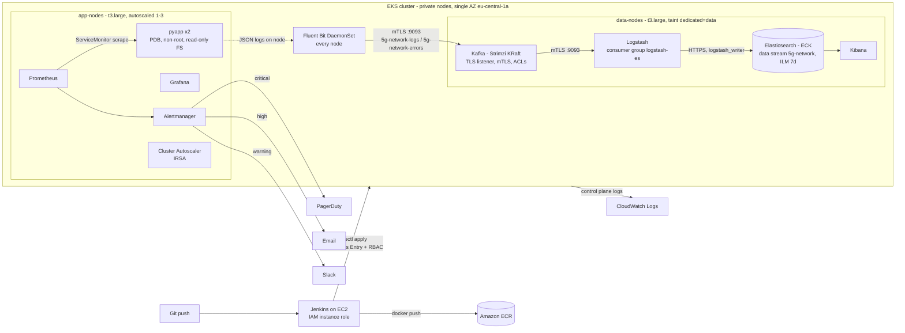
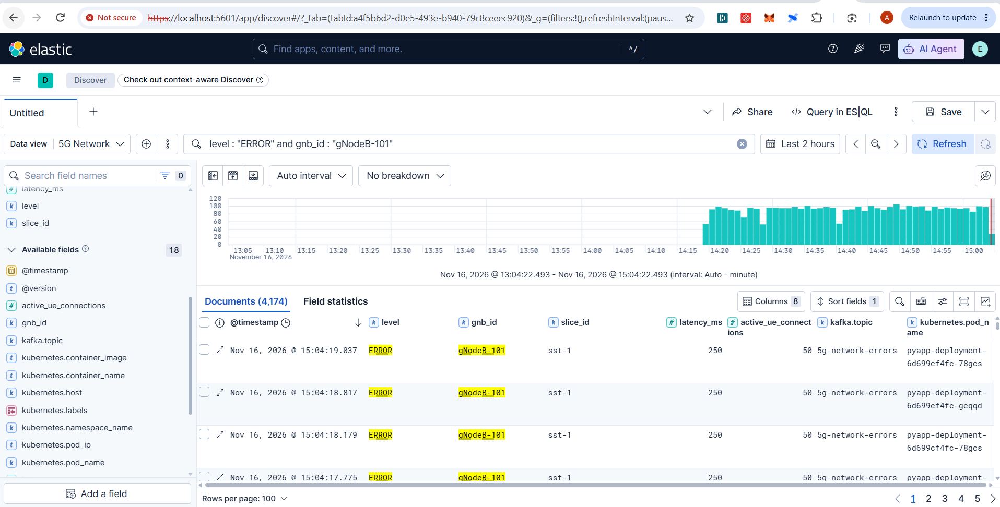

# 5G Network Intelligence Platform on Amazon EKS

A production-style Kubernetes platform for a telecom observability workload: a Python service that
simulates 5G RAN session telemetry (per gNodeB and network slice), deployed on Amazon EKS through a
Jenkins pipeline, monitored with Prometheus/Grafana, with a log pipeline Fluent Bit → Kafka → Logstash →
Elasticsearch → Kibana. Every hop is encrypted and every client has its own identity and least-privilege access.

The focus is on how the platform is operated, not on the application: least-privilege IAM, encryption
at rest, workload isolation, availability during change, and alerting that maps to service impact.

---

## Architecture



### Node groups

| Node group | Instance | Scaling | Scheduling | Workloads |
|---|---|---|---|---|
| `app-nodes` | t3.large | 1–3, Cluster Autoscaler | label `workload=apps`, no taint | pyapp, Prometheus, Grafana, Alertmanager, Cluster Autoscaler, CoreDNS, metrics-server, EBS CSI controller |
| `data-nodes` | t3.large | 0–1, Cluster Autoscaler | label `workload=data`, taint `dedicated=data:NoSchedule` | Kafka, Strimzi entity operator, Elasticsearch, Logstash, Kibana |
| all nodes | — | DaemonSet | tolerates all `NoSchedule` taints | Fluent Bit |

Both node groups are pinned to **one Availability Zone**. EBS volumes cannot move between AZs; with a
multi-AZ node group, a rescheduled stateful pod can end up in a zone where its volume cannot attach and
stay `Pending`. Production would use one node group per AZ with workload replicas spread across them.

The application node group is intentionally **not tainted**: system add-ons (CoreDNS, metrics-server,
EBS CSI controller) carry no toleration for custom taints. Placement on `app-nodes` is enforced with
`nodeSelector`; exclusion from `data-nodes` is enforced with the taint.

---

## Security controls

| Area | Control | Where |
|---|---|---|
| Encryption at rest | Kubernetes Secrets encrypted in etcd with a customer-managed KMS key | `k8s/cluster-config.yaml` (`secretsEncryption`) |
| Encryption at rest | Node root volumes and all persistent volumes (gp3) encrypted | `cluster-config.yaml`, `k8s/storageclass-gp3.yaml` |
| Data retention | `reclaimPolicy: Retain` on the StorageClass, `deleteClaim: false` on Kafka | `storageclass-gp3.yaml`, `Kafka/kafka-cluster.yaml` |
| Encryption in transit | Kafka exposes only a TLS listener; clients authenticate with per-client certificates (mTLS). EKS API, ECR and AWS APIs over TLS | `Kafka/kafka-cluster.yaml` |
| Kafka authorization | Per-client ACLs (producer: Write on `5g-network-*`; consumer: Read + one consumer group) and byte-rate quotas | `Kafka/kafka-users.yaml` |
| Key material | Client private keys are issued in the client namespace by the Strimzi User Operator; only the public cluster CA is copied | `Kafka/sync-cluster-ca.sh` |
| Elasticsearch | HTTPS with an ECK-managed CA; Logstash writes with a dedicated `logstash_writer` role (create only, `5g-network*` only), never as the `elastic` superuser | `Elastic/es-bootstrap.yaml` |
| Generated credentials | The Logstash password is generated at install time (`openssl rand`) straight into a Secret; it is never typed, logged or committed | Deployment steps |
| Operator scope | ECK manages only the `logging` namespace; Strimzi watches only `kafka` and `logging` | `Elastic/eck-values.yaml`, `Kafka/strimzi-values.yaml` |
| IAM | IRSA for Cluster Autoscaler and EBS CSI driver; node roles carry no autoscaling rights | `cluster-config.yaml` |
| IAM | Autoscaler can only change ASGs tagged `k8s.io/cluster-autoscaler/bootcamp-cluster=owned` | `k8s/eks-cluster-autoscaler-policy.json` |
| IAM | Jenkins uses an EC2 instance role (no static keys) and an EKS Access Entry (no `aws-auth` ConfigMap) | `cluster-config.yaml` (`accessConfig`) |
| Kubernetes RBAC | CI/CD identity limited to one namespace; write-only on Secrets (no get/list) | `k8s/jenkins-rbac.yaml` |
| Workload hardening | Non-root UID 10001, read-only root filesystem, all capabilities dropped, no privilege escalation, seccomp `RuntimeDefault` | `k8s/pyapp-deployment.yaml`, `Dockerfile` |
| Network | Worker nodes on private subnets only; no SSH, node access through SSM | `cluster-config.yaml` |
| Network | Public API endpoint restricted with `publicAccessCIDRs` (admin/VPN and Jenkins egress) | `cluster-config.yaml` |
| Audit | EKS control plane logs (api, audit, authenticator, controllerManager, scheduler) to CloudWatch | `cluster-config.yaml` |
| Secrets in Git | None. Alertmanager credentials are mounted from a Kubernetes Secret and read through `*_file` fields | `Prometheus/alertmanager.yaml` |

Verified least privilege for the CI identity:

```bash
kubectl auth can-i create poddisruptionbudgets -n telecom-apps --as jenkins-pipeline --as-group cicd-deployers   # yes
kubectl auth can-i get secrets               -n telecom-apps --as jenkins-pipeline --as-group cicd-deployers   # no
kubectl auth can-i create deployments        -n kube-system  --as jenkins-pipeline --as-group cicd-deployers   # no
```

---

## Availability during change

- `maxUnavailable: 0`, `maxSurge: 1`: a new pod must pass its readiness probe before an old one is removed.
- `PodDisruptionBudget` (`minAvailable: 1`): node drains (autoscaler scale-down, node group replacement)
  never evict both replicas at once. The migration from the original multi-AZ node group to `app-nodes`
  was done with `eksctl delete nodegroup --drain` without application downtime.
- Separate liveness and readiness probes: liveness restarts a hung process, readiness removes it from
  the Service endpoints.
- Node agents run with `priorityClassName: system-node-critical`. On a full node (the original t3.medium node
  group was limited to 17 pods by the number of ENI IP addresses) Fluent Bit preempts a lower-priority pod instead of staying
  `Pending`, so no node is left without log collection. The preempted pod is rescheduled on another node
  in the same AZ, where its EBS volume can attach.

---

## Observability



The application exposes Prometheus metrics on `/metrics` and writes structured JSON logs to stdout.
It runs a built-in failure scenario (traffic baseline for 30 s, then RAN latency and UE-drop degradation)
so the alert path can be exercised end to end.

| Alert | Severity | Signal |
|---|---|---|
| `PyAppServiceDegraded` | critical | Fewer than 50% of replicas up, or the target is absent |
| `PyAppSinglePodDown` | warning | One replica failing scrapes for 5 min |
| `PyAppHighMemoryUsage` | warning | Working set above 85% of the memory limit |
| `HighRANLatency` | critical | Max latency per gNodeB/slice above 150 ms for 3 min |
| `MassiveUEDrop` | critical | Active UE connections below 100 after a peak above 1000 in the last hour |
| `HighApplicationErrorLogs` | warning | ERROR events above 5% of traffic per slice, with a minimum-traffic guard |

Routing: `critical` → PagerDuty, `high` → email, `warning` → Slack. Inhibition rules suppress lower
severities for the same `namespace`/`job` while a higher-severity alert is firing. Every alert carries a
`runbook_url`.

Service identity labels (`service`, `namespace`, `pod`, `job`) come from Kubernetes service discovery;
the application only emits business labels (`slice_id`, `gnb_id`, `level`).

---

## Repository layout

```
Dockerfile                       multi-stage build, non-root runtime
Jenkinsfile                      build → push to ECR → deploy to EKS
pyApp/app.py                     5G session telemetry simulator (metrics + JSON logs)
k8s/
  cluster-config.yaml            eksctl: cluster, KMS, logging, IRSA, access entries, node groups
  eks-cluster-autoscaler-policy.json
  storageclass-gp3.yaml          encrypted gp3, WaitForFirstConsumer, Retain
  jenkins-rbac.yaml              namespace-scoped CI/CD role
  pyapp-deployment.yaml          Deployment, PodDisruptionBudget, Service
Prometheus/
  values.yaml                    kube-prometheus-stack values
  alertmanager.yaml              routing, inhibition, receivers (no credentials)
  pyapp-servicemonitor.yaml
  pyapp-alerts.yaml              availability and saturation rules
  pyapp-business-alerts.yaml     RAN / slice level rules
Kafka/
  strimzi-values.yaml            Strimzi operator Helm values
  kafka-cluster.yaml             KRaft node pool + cluster: TLS/mTLS listener, ACLs, data-node placement
  kafka-topic.yaml               5g-network-logs, 5g-network-errors
  kafka-users.yaml               fluent-bit-producer, logstash-consumer (certificates, ACLs, quotas)
  sync-cluster-ca.sh             copies the public cluster CA to the client namespace
  kcat-debug.yaml                temporary test client
  kafka-setup.md                 design decisions, install and verification steps
FluentBit/
  values.yaml                    log collection, Kubernetes metadata, ERROR routing, Kafka TLS output
Elastic/
  eck-values.yaml                ECK operator Helm values
  elasticsearch.yaml             Elasticsearch (single node, data-nodes) + Kibana
  es-bootstrap.yaml              Job: ILM policy, index template / mapping, logstash_writer role and user
  logstash.yaml                  Kafka (mTLS) -> Elasticsearch (HTTPS) pipeline
stepsTaken.md                    full rebuild guide, step by step (Romanian)
```

---

## Deployment

Prerequisites: AWS CLI, `eksctl`, `kubectl`, `helm`; a KMS key and the IAM policy from
`k8s/eks-cluster-autoscaler-policy.json`; a Jenkins EC2 instance with the `Jenkins-EKS-ECR-Role`
instance role and an ECR repository.

```bash
# 1. Cluster and node groups
eksctl create cluster -f k8s/cluster-config.yaml

# 2. Storage
kubectl apply -f k8s/storageclass-gp3.yaml

# 3. Cluster Autoscaler (service account created by eksctl with IRSA)
helm repo add autoscaler https://kubernetes.github.io/autoscaler
helm install cluster-autoscaler autoscaler/cluster-autoscaler --version 9.60.0 -n kube-system \
  --set autoDiscovery.clusterName=bootcamp-cluster \
  --set awsRegion=eu-central-1 \
  --set rbac.serviceAccount.create=false \
  --set rbac.serviceAccount.name=cluster-autoscaler \
  --set nodeSelector.workload=apps

# 4. Application namespace and CI/CD permissions (applied by a cluster admin, not by Jenkins)
kubectl create namespace telecom-apps
kubectl apply -f k8s/jenkins-rbac.yaml
# Then run the Jenkins pipeline: it builds, pushes to ECR and applies k8s/pyapp-deployment.yaml.
```

### Alerting

The Alertmanager configuration and its credentials are two separate Secrets. Credentials are read from
files outside the repository so they do not end up in shell history.

```bash
kubectl create namespace monitoring

kubectl -n monitoring create secret generic alertmanager-config \
  --from-file=alertmanager.yaml=Prometheus/alertmanager.yaml

kubectl -n monitoring create secret generic alertmanager-credentials \
  --from-file=smtp-password=$HOME/.secrets/smtp-password \
  --from-file=pagerduty-routing-key=$HOME/.secrets/pagerduty-routing-key \
  --from-file=slack-webhook-url=$HOME/.secrets/slack-webhook-url

helm repo add prometheus-community https://prometheus-community.github.io/helm-charts
helm install monitoring prometheus-community/kube-prometheus-stack --version 93.3.0 \
  -n monitoring -f Prometheus/values.yaml

kubectl apply -f Prometheus/pyapp-servicemonitor.yaml \
              -f Prometheus/pyapp-alerts.yaml \
              -f Prometheus/pyapp-business-alerts.yaml
```

The Helm release name must be `monitoring`: the ServiceMonitor and PrometheusRules are selected by the
`release: monitoring` label.

### Log pipeline (Fluent Bit → Kafka)

Fluent Bit tails the pyapp container logs, enriches them with Kubernetes metadata and publishes them to
Kafka over mTLS. Events with `level=ERROR` go to `5g-network-errors` (24 h retention), everything else to
`5g-network-logs` (6 h). The message key is `gnb_id`, so events of one gNodeB stay ordered within a
partition. Fluent Bit buffers on disk and retries while Kafka is unavailable.

Logstash consumes both topics as consumer group `logstash-es` (mTLS identity `logstash-consumer`), drops
redundant fields (including the ECS `event.original` copy that would double index size) and writes to the
`5g-network` data stream. The index template maps `gnb_id`, `slice_id` and `level` as keywords and
`latency_ms` as a number, so Kibana searches like `level:"ERROR" and gnb_id:"gNodeB-101"` and latency
charts work without guessed mappings. ILM rolls the index daily and deletes it after 7 days.

Install and verification steps: [`Kafka/kafka-setup.md`](Kafka/kafka-setup.md) (Kafka, Fluent Bit) and below
(Elastic).

```bash
helm repo add elastic https://helm.elastic.co
helm install elastic-operator elastic/eck-operator --version 3.5.0 \
  -n elastic-system --create-namespace -f Elastic/eck-values.yaml
kubectl apply -f Elastic/elasticsearch.yaml
kubectl wait elasticsearch/logs -n logging --for=jsonpath='{.status.phase}'=Ready --timeout=600s

kubectl create secret generic logstash-es-writer -n logging \
  --from-literal=password="$(openssl rand -hex 24)"
kubectl apply -f Elastic/es-bootstrap.yaml
kubectl wait job/es-bootstrap -n logging --for=condition=complete --timeout=180s
kubectl apply -f Elastic/logstash.yaml

# Kibana (no public endpoint): https://localhost:5601, user elastic
kubectl get secret logs-es-elastic-user -n logging -o jsonpath='{.data.elastic}' | base64 -d; echo
kubectl port-forward -n logging svc/logs-kb-http 5601:5601
```

---

## Lab scope versus production

| Topic | This lab | Production |
|---|---|---|
| Availability Zones | Single AZ (cost, EBS affinity) | One node group per AZ, replicas spread with topology constraints |
| API endpoint | Public, restricted by CIDR | Private only, reached through VPN / bastion / SSM |
| NAT | Single NAT gateway | One NAT gateway per AZ |
| Kafka | 1 broker, replication factor 1 | 3+ brokers across AZs, RF 3, `min.insync.replicas: 2` |
| Prometheus | 1 replica, 15 d local retention | 2 replicas, long-term storage (Thanos / Amazon Managed Prometheus) |
| Elasticsearch | 1 node, 0 replicas, mmap disabled | 3+ nodes across AZs, 1 replica, `vm.max_map_count` set on nodes, snapshots to S3 |
| Kibana access | `kubectl port-forward`, built-in `elastic` user | SSO (SAML/OIDC) with role-based spaces, behind VPN |
| Backups | `Retain` protects against deletion only | Scheduled EBS snapshots (AWS Backup / VolumeSnapshot) |

## Teardown

Order matters: volumes must be released while the EBS CSI driver is still running, and with
`reclaimPolicy: Retain` deleting a PersistentVolume object does **not** delete the EBS volume.

```bash
# 1. Workloads that own AWS resources (EBS volumes, load balancers)
kubectl delete -f Elastic/logstash.yaml -f Elastic/elasticsearch.yaml
helm uninstall elastic-operator -n elastic-system
helm uninstall fluent-bit -n logging
kubectl delete -f Kafka/kafka-users.yaml -f Kafka/kafka-topic.yaml -f Kafka/kafka-cluster.yaml
helm uninstall strimzi-cluster-operator -n kafka
helm uninstall monitoring -n monitoring

# 2. Claims (Kafka keeps its PVC by design: deleteClaim: false)
kubectl delete pvc --all -n kafka
kubectl delete pvc --all -n monitoring
kubectl delete pvc --all -n logging

# 3. Retained volumes: note the EBS volume IDs, then remove the PV objects
kubectl get pv -o custom-columns=PV:.metadata.name,EBS:.spec.csi.volumeHandle,CLAIM:.spec.claimRef.name
kubectl delete pv --all

# 4. Nothing may still hold a load balancer in the VPC
kubectl get svc -A | grep LoadBalancer        # expected: empty

# 5. Cluster, node groups, NAT gateway and VPC (CloudFormation stacks)
eksctl delete cluster -f k8s/cluster-config.yaml --wait

# 6. Billing check: unattached EBS volumes (Retain), NAT gateways, Elastic IPs
aws ec2 describe-volumes --region eu-central-1 --filters Name=status,Values=available \
  --query "Volumes[].{ID:VolumeId,Size:Size,Created:CreateTime}"
aws ec2 delete-volume --region eu-central-1 --volume-id <vol-id>     # for each volume no longer needed
aws ec2 describe-nat-gateways --region eu-central-1 --filter Name=state,Values=available --query "NatGateways[].NatGatewayId"
aws ec2 describe-addresses --region eu-central-1 --query "Addresses[].PublicIp"
```

To pause instead of deleting, scale the data tier to zero:
`eksctl scale nodegroup --cluster bootcamp-cluster --name data-nodes --nodes 0`.

---

## Roadmap

1. Kafka consumer-lag and Elasticsearch health alerts (Kafka Exporter, elasticsearch-exporter) in Prometheus.
2. NetworkPolicies (default deny per namespace) with VPC CNI network policy enforcement; the Kafka listener policy is already generated by Strimzi.
3. MinIO as S3-compatible snapshot repository for Elasticsearch.
4. CloudWatch security alarms on CloudTrail (root usage, IAM/KMS/security group changes, console login without MFA) and GuardDuty EKS findings.
5. Image vulnerability scanning (Trivy) as a pipeline gate.
6. VPC CNI prefix delegation to lift the per-node pod limit (~110) instead of sizing instances up for IP capacity.
